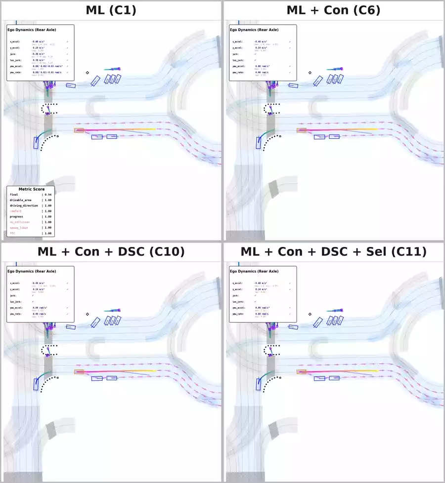
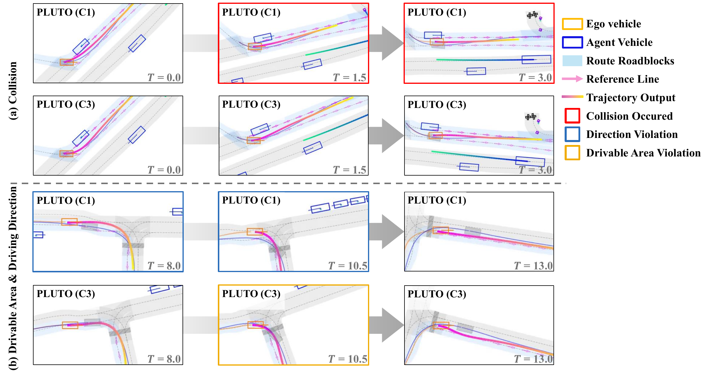
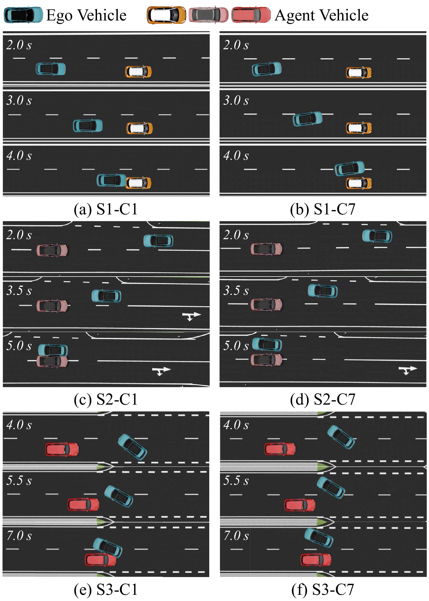
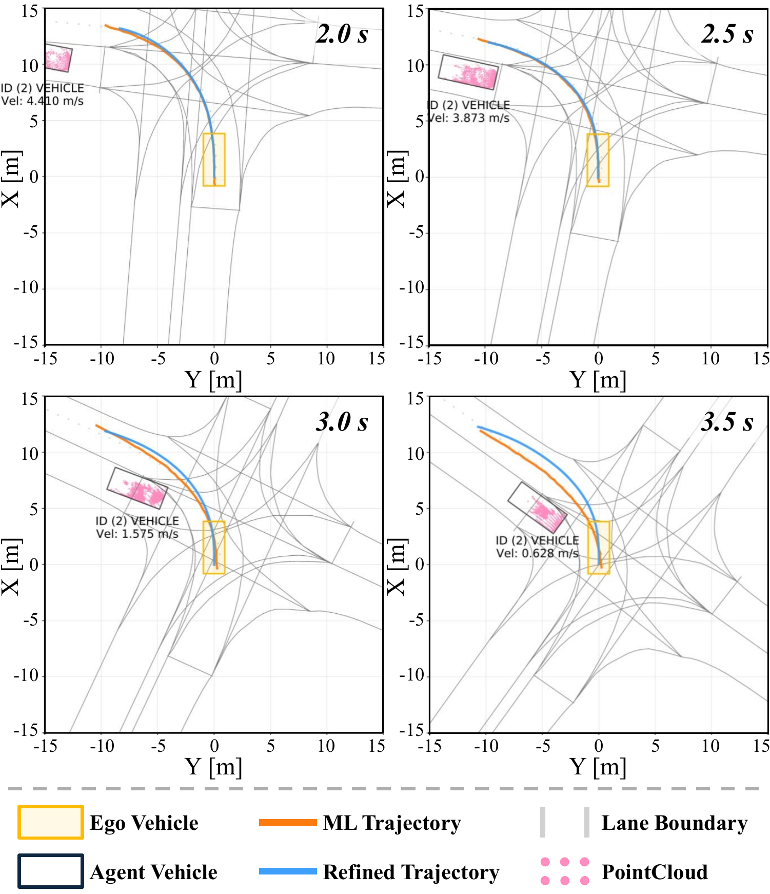

# A Refinement and Verification Pipeline for Learning-Based Planning: Temporal Consistency, Dynamics Feasibility, and Comfort

**Paper:** [A Refinement and Verification Pipeline for Learning-Based Planning: Temporal Consistency, Dynamics Feasibility, and Comfort]

**Authors:** Seungwoo Heo1, Seheon Ha1, Jahyun Koo1, Jiwon Seok2, Yuseung Na2, Paulo Resende3, Thomas Heitzmann3, and Kichun Jo2,\*

**Affiliations:**

1. Department of Automotive Engineering (Automotive-Software Convergence), Hanyang University, Seoul 04763, Republic of Korea
2. Department of Automotive Engineering, Hanyang University, Seoul 04763, Republic of Korea
3. Driving Automation anSWer, Valeo Brain Division, Valeo, 6 rue Daniel Costantini, Créteil 94000, France

\* Corresponding author

**YouTube:** [Real-Vehicle Comfort Demo Supplementary Videos](TBD)

## Abstract

Learning-based motion planners infer driving behavior from data, reducing reliance on hand-crafted rules. However, closed-loop deployment remains difficult because their outputs can fluctuate across planning cycles, violate vehicle dynamics and friction limits, and degrade ride comfort through unnecessary acceleration and steering oscillations. Prior safety filters and low-level control corrections can mitigate immediate violations, but they do not provide a unified mechanism that enforces trajectory-level consistency, executability, and risk-aware validation at the planner output. This paper proposes a refinement-and-verification trajectory processing pipeline that improves closed-loop execution without replacing the underlying planner. The pipeline combines a Kalman filter-based consistency refinement across planning cycles, an NMPC-based Dynamic-Safety-Comfort refinement that enforces vehicle dynamics together with safety and comfort constraints, and a risk-aware verification and selection stage based on friction limits, collision risk, and driving-quality metrics. On the NuPlan closed-loop benchmark, the full pipeline improves ride-comfort metrics by more than 10% and increases collision- and TTC-related safety metrics by about 4%, yielding a consistent gain in the overall planning score. Additional evaluation in CarMaker and real-vehicle experiments shows that the refined trajectories remain dynamically feasible and can be stably tracked without sacrificing task-level driving performance. These results support the role of a structured trajectory-level intermediate layer for bridging learning-based planning and real-world execution.

## Pipeline Ablation on the nuPlan Closed-Loop Benchmark

The four configurations below are rendered from the same nuPlan closed-loop scenario and played in sync, so the contribution of each pipeline stage can be compared directly. All four runs use **Pluto** as the base learning-based planner, and the grid is ordered **C1 → C6 → C10 → C11**, adding one stage at a time from the baseline planner to the full pipeline.

  
   
  <em>Click the preview to open the full-resolution video (2040 &times; 2216, 10 Hz, 14.9 s).</em>

### Legend

| Position | Configuration | Con | DSC | Sel | Description |
| :--- | :--- | :---: | :---: | :---: | :--- |
| Top-left | **ML (C1)** | | | | Baseline learning-based planner output, used as the reference |
| Top-right | **ML + Con (C6)** | ✓ | | | Adds temporal consistency refinement across planning cycles |
| Bottom-left | **ML + Con + DSC (C10)** | ✓ | ✓ | | Adds refinement under vehicle dynamics, safety, and comfort constraints |
| Bottom-right | **ML + Con + DSC + Sel (C11)** | ✓ | ✓ | ✓ | Full pipeline with risk-aware verification and selection |

**Pipeline stages**

- **Con** — Temporal consistency refinement across planning cycles, based on a Kalman filter.
- **DSC** — Dynamic-Safety-Comfort refinement, an NMPC that enforces vehicle dynamics together with safety and comfort constraints.
- **Sel** — Risk-aware verification and selection, based on friction limits, collision risk, and driving-quality metrics.

**On-screen overlays**

- **Ego Dynamics (Rear Axle)**, at the top-left of each tile, reports the current longitudinal and lateral acceleration, jerk, longitudinal jerk, yaw acceleration, and yaw rate. The admissible bound is printed under each quantity, and a check mark indicates that the current value stays within it.
- **Metric Score**, at the bottom-left of each tile, reports the nuPlan closed-loop metric scores accumulated up to the current frame.

**Individual videos**

| Configuration | File |
| :--- | :--- |
| ML (C1) | [ML_(C1).mp4](Videos/ML_%28C1%29.mp4) |
| ML + Con (C6) | [ML_Con(C6).mp4](Videos/ML_Con%28C6%29.mp4) |
| ML + Con + DSC (C10) | [ML_Con_DSC(C10).mp4](Videos/ML_Con_DSC%28C10%29.mp4) |
| ML + Con + DSC + Sel (C11) | [ML_Con_DSC_Sel(C11).mp4](Videos/ML_Con_DSC_Sel%28C11%29.mp4) |

### Closed-Loop Rollout Comparison

  

**Fig. 6. Closed-loop rollout comparison of Pluto (C1) and Pluto with DS refinement (C3) in two turning scenarios.** (a) Left-turn obstacle avoidance at *T* = 0.0, 1.5, and 3.0 s: C1 collides with a parked vehicle (red border), while C3 produces a collision-free evasive maneuver. (b) Right-turn case at *T* = 8.0, 10.5, and 13.0 s: C1 exhibits a driving-direction violation (blue border), while C3 restores the correct driving direction, with a temporary drivable-area violation (yellow border) observed in this example. &nbsp;[[vector PDF]](Figures/Fig6_nuplan_closed_loop_rollout_C1_vs_C3.pdf)

## Collision-Avoidance Evaluation in CarMaker

Three collision-critical scenarios (S1–S3) were reproduced in CarMaker to check whether the refinement pipeline turns an unsafe planner output into an executable evasive maneuver under a full vehicle dynamics model.

  

**Fig. 7. Comparison of vehicle behaviors in collision avoidance scenarios (S1–S3).** The left column ((a), (c), (e)) shows the baseline Pluto following its original trajectory, which leads to collisions across all scenarios as no effective evasive maneuver is generated. The right column ((b), (d), (f)) illustrates the refined trajectory case under the same conditions, where evasive maneuvers are executed, resulting in collision avoidance. &nbsp;[[vector PDF]](Figures/Fig7_carmaker_collision_avoidance_S1_S3.pdf)

## Real-Vehicle Collision Avoidance at K-City

  

**Fig. 9. Real-vehicle reproduction of the S3 collision-avoidance scenario at K-City.** The ego vehicle is executed in closed loop by tracking the refined trajectory (C10, cyan). The raw ML trajectory (C1, orange) is generated in the same planning cycles but is *not executed*; it is overlaid only to visualize the difference in planned geometry. Across the snapshots from 2.0 s to 3.5 s, the executed trajectory C10 steers the ego vehicle away from the conflict region with the interacting vehicle. &nbsp;[[vector PDF]](Figures/Fig9_real_vehicle_S3_kcity.pdf)

## Real-Vehicle Comfort Demo Supplementary Videos

The real-vehicle experiments were conducted at **K-City**, the autonomous driving proving ground operated by the Korea Transportation Safety Authority (KATRI).

The experimental platform was a research-grade **Hyundai IONIQ 5** equipped with a **128-channel LiDAR, blind-spot LiDARs, a MEMS LiDAR, RTK-GNSS, and an onboard PC with a CAN interface**. The full planning and refinement pipeline was deployed onboard and operated in closed loop at **10 Hz**.

For real-vehicle comfort evaluation, two representative scenarios from the paper are shared in this repository. Each video is presented in a side-by-side format for qualitative comparison, with **ML on the left** and **Refined on the right**.

### Scenario 4: Arterial Driving

This scenario evaluates ride comfort during arterial-road driving with lane changes under the condition of **ego speed below 50 km/h**.

**YouTube Link:** [Scenario 4 Video](TBD)

### Scenario 5: Urban Driving with Stop-and-Go

This scenario evaluates ride comfort during urban driving with repeated stop-and-go behavior under the condition of **ego speed below 30 km/h**.

**YouTube Link:** [Scenario 5 Video](TBD)
